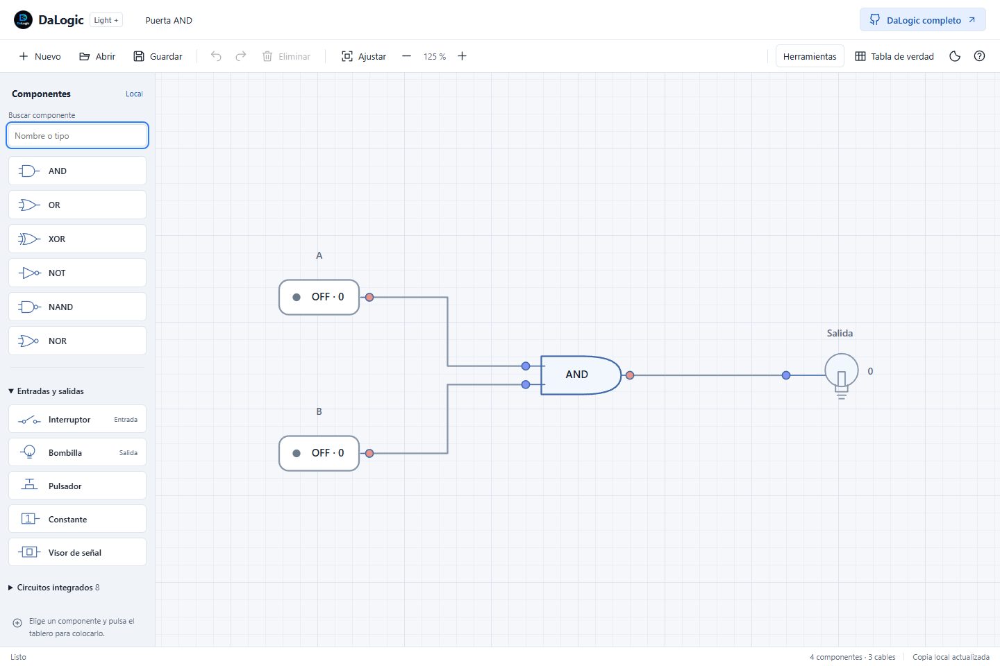

# DaLogic Light

Editor y simulador de circuitos lógicos combinacionales que funciona directamente en el navegador. Diseña conexiones, prueba señales y comparte circuitos sin instalar la aplicación de escritorio.

**HTML, CSS y JavaScript · Sin dependencias de ejecución · Sin servidor de aplicación · Apache 2.0**

[Primeros pasos](#primeros-pasos) · [Ejemplos](examples/README.md) · [Publicar en GitHub](docs/PUBLICACION.md) · [Cambios](CHANGELOG.md) · [DaLogic completo](https://github.com/davidlb025/DaLogic)



La interfaz identifica esta edición como **Light +**. Este repositorio prepara su primera distribución como **DaLogic Light 1.0.0**; la versión de la aplicación es independiente de las versiones de los formatos `.dalogic` y `.dmodule`.

## Qué puedes hacer

- Construir circuitos con AND, OR, XOR, NOT, NAND y NOR; las puertas de varias entradas admiten de 2 a 8.
- Usar interruptores, pulsadores, constantes de un bit, bombillas y visores de señal.
- Simular señales `0`, `1` y `X` —indeterminada— mientras editas.
- Buscar componentes y utilizar 8 circuitos integrados combinacionales incluidos: comparador de 1 bit, semirrestador, semisumador, sumador completo, decodificador 2 a 4, paridad par de 4 bits, DEMUX 1 a 2 y MUX 2 a 1.
- Crear CI a partir del circuito, importarlos desde `.dmodule` y conservar hasta 30 CI personales en el navegador.
- Seleccionar, mover, copiar, cortar, pegar, duplicar, alinear y distribuir componentes, con deshacer y rehacer.
- Dibujar cables con codos, acercar, alejar y ajustar el tablero al circuito.
- Revisar entradas libres, señales indeterminadas y salidas sin utilizar.
- Obtener tablas de verdad y descargarlas en CSV; exportar el circuito a PNG y SVG.
- Guardar y abrir proyectos `.dalogic`, recuperar una copia local y alternar entre tema claro y oscuro.

## Primeros pasos

1. Descarga el ZIP web de una publicación y **extráelo completo**. También puedes descargar el código del repositorio.
2. Abre `index.html` en un navegador moderno con JavaScript habilitado. Mantén los archivos JavaScript, CSS y el icono junto al HTML.
3. El ejemplo AND se carga al iniciar una sesión sin copia local. Pulsa sus interruptores y comprueba la bombilla.
4. Para empezar de cero, pulsa **Nuevo**. Elige un componente y pulsa el tablero para colocarlo, o arrástralo desde la lista.
5. Pulsa una salida y después una entrada para conectarlas. Los clics intermedios añaden codos; **Esc** cancela el cable.
6. Pulsa **Guardar** para descargar un `.dalogic`. El autoguardado del navegador no sustituye esa copia.

La aplicación no requiere Python, Node.js, `npm install` ni compilación para utilizarla. Si el navegador restringe el almacenamiento al abrir archivos locales, sirve la carpeta por HTTP. Por ejemplo, si ya tienes Python:

```powershell
python -m http.server 8000 --bind 127.0.0.1
```

Abre <http://127.0.0.1:8000> y detén el servidor con **Ctrl+C**. El servidor solo sirve los archivos estáticos.

### Circuitos de ejemplo

Abre desde la aplicación [puerta-and.dalogic](examples/puerta-and.dalogic), [semisumador.dalogic](examples/semisumador.dalogic) o [multiplexor.dalogic](examples/multiplexor.dalogic). También se incluye [semisumador.dmodule](examples/semisumador.dmodule) para probar **Herramientas → Importar CI .dmodule**.

## Controles y atajos

| Acción | Control |
| --- | --- |
| Nuevo / abrir / guardar | Ctrl+N / Ctrl+O / Ctrl+S |
| Deshacer / rehacer | Ctrl+Z / Ctrl+Y o Ctrl+Mayús+Z |
| Copiar / cortar / pegar / duplicar | Ctrl+C / Ctrl+X / Ctrl+V / Ctrl+D |
| Seleccionar todo / eliminar | Ctrl+A / Supr o Retroceso |
| Ajustar / acercar / alejar | Ctrl+0 / Ctrl++ / Ctrl+- |
| Zoom / desplazar | Rueda / Espacio + arrastre o botón central |
| Selección múltiple | Arrastrar sobre el fondo; Mayús añade a la selección |
| Mover la selección | Flechas con el tablero enfocado; Mayús amplía el paso |
| Colocar el componente activo | Clic en el tablero o Enter con el tablero enfocado |
| Pulsador | Mantener pulsado; también Espacio con el pulsador seleccionado en el tablero |
| Cancelar conexión / ayuda | Esc / F1 |

En macOS, los atajos de edición aceptan **⌘** en lugar de Ctrl. El navegador puede reservar algunos atajos. En pantallas táctiles, el fondo permite desplazar y dos dedos permiten hacer zoom; el editor ofrece más espacio de trabajo en ordenador.

## Light y DaLogic completo

| | DaLogic Light | [DaLogic de escritorio](https://github.com/davidlb025/DaLogic) |
| --- | --- | --- |
| Ejecución | Navegador, archivos estáticos | Aplicación Python/PySide6 o distribución Windows |
| Simulación | Combinacional, un bit por puerto | También buses, memoria, temporización y realimentación |
| Componentes | Puertas, entradas/salidas y CI combinacionales | Biblioteca ampliada, aritmética, memoria y periféricos |
| Exportación | Circuito PNG/SVG; tabla CSV | Más formatos y herramientas de análisis |
| Uso recomendado | Aprendizaje, ejemplos y circuitos combinacionales | Proyectos que requieren componentes o simulación avanzados |

Light abre proyectos del **formato DaLogic 1** que utilicen el subconjunto compatible. Rechaza memoria, realimentación, buses de más de un bit, retardos, rotación, espejo, nexos y anotaciones de la edición completa. Compartir extensión de archivo no garantiza que cualquier proyecto de escritorio se pueda abrir en Light.

Los CI importados deben tener una tabla combinacional completa, de hasta 8 entradas y 8 salidas de un bit, sin memoria ni retardos. Se aceptan las versiones de formato `1` y `1.2` cuando cumplen esas condiciones; Light exporta `.dmodule` versión `1`. Prueba el archivo en la edición de destino antes de intercambiar proyectos importantes.

### Límites

| Recurso | Límite |
| --- | --- |
| Componentes / cables por circuito | 2.000 / 8.000 |
| Archivo `.dalogic` al abrir o guardar | 2 MiB |
| Tabla de verdad | 8 interruptores/pulsadores, 256 combinaciones y 8.192 celdas |
| CI creado desde el circuito | De 1 a 8 entradas y de 1 a 8 salidas |
| Archivo `.dmodule` importado | 128 KiB |
| Biblioteca personal | 30 CI por navegador y origen |
| Tablas de CI dentro del circuito | 65.536 celdas de salida en total |

Las constantes mantienen su valor durante el cálculo de la tabla de verdad. El rendimiento práctico depende del circuito y del dispositivo; los máximos de validación no son una garantía de fluidez.

## Archivos y almacenamiento

Los circuitos se procesan en tu navegador. El código no incorpora cuentas, analítica, servicios remotos ni envío de proyectos. Al usar una versión alojada se descargan los archivos del sitio; el proveedor de alojamiento puede registrar esas peticiones. El enlace a DaLogic completo abre GitHub.

La copia del circuito, la vista y el tema se guardan en `localStorage` con la clave `dalogic-light-plus-v1`. Los CI personales usan `dalogic-light-plus-library-v1`. Es una copia del circuito actual, no un archivo de todos tus proyectos: crear o abrir otro circuito puede reemplazarla.

El almacenamiento depende del navegador y del origen: cambiar de navegador, puerto o dirección, borrar los datos del sitio o cerrar una sesión privada puede dejarte sin esa copia. Con `file://` su disponibilidad depende del navegador. Descarga tus `.dalogic` y `.dmodule` antes de borrar datos o cambiar de equipo. Los CI usados por un proyecto se incluyen en su archivo.

## Desarrollo y comprobación

Para editar la aplicación basta con modificar los archivos y recargar el navegador. Las herramientas de preparación requieren **Node.js 22 o posterior** y solo usan módulos integrados; no es necesario instalar paquetes.

```powershell
npm run check
npm run build
npm run package
```

- `check` verifica sintaxis, archivos de distribución, enlaces locales y ejemplos con el motor real.
- `build` repite esas comprobaciones y genera `dist/site/`, listo para alojamiento estático.
- `package` genera los ZIP web y de fuentes y `dist/SHA256SUMS.txt` con sus huellas SHA-256.

Los flujos de GitHub Actions comprueban los cambios, publican `main` en GitHub Pages cuando está habilitado y preparan una Release en borrador al subir una etiqueta `vX.Y.Z`. Consulta [la guía de publicación](docs/PUBLICACION.md) para la configuración inicial y los comandos.

```text
index.html       Interfaz y diálogos
styles.css       Estilos, temas y adaptación al tamaño de pantalla
core.js          Modelo, validación, formatos y simulación sin DOM
library.js       Ocho CI combinacionales incluidos
app.js           Editor Canvas, interacción, almacenamiento y exportación
examples/        Circuitos y módulo de ejemplo
docs/            Captura, publicación y notas de versión
scripts/         Comprobación y empaquetado sin dependencias
.github/         CI, Pages, Release y plantillas de colaboración
```

Las comprobaciones automáticas no sustituyen una revisión visual y de descargas en los navegadores de destino. Para contribuir, consulta [CONTRIBUTING.md](CONTRIBUTING.md).

## Autor y licencia

Creado por **David Lopez Borrego**, a partir del proyecto [DaLogic](https://github.com/davidlb025/DaLogic). Distribuido con licencia [Apache 2.0](LICENSE). Conserva [LICENSE](LICENSE) y [NOTICE](NOTICE) al redistribuir el código o los paquetes.
